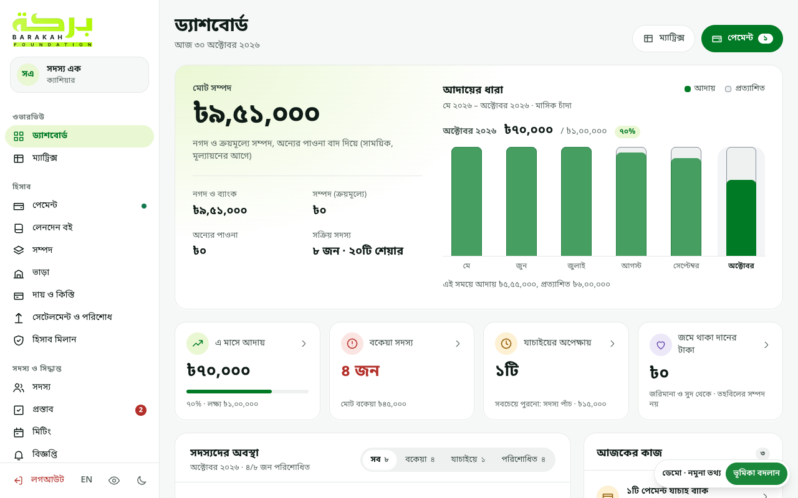
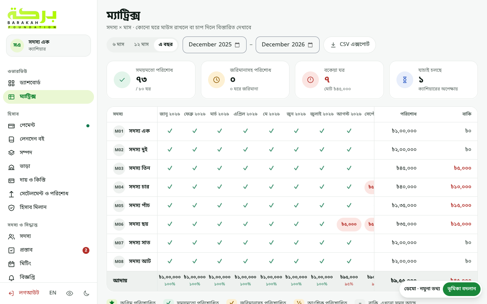
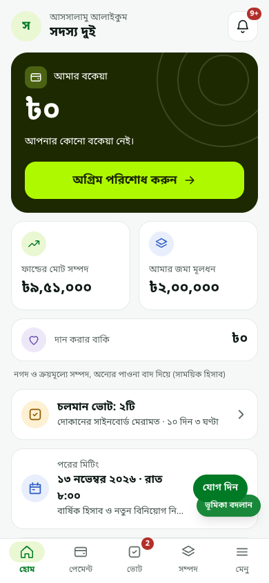
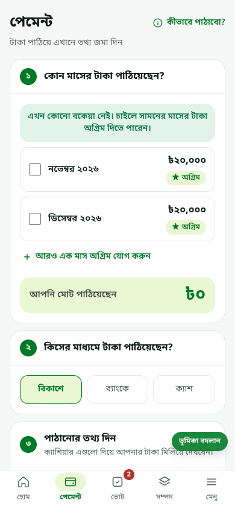
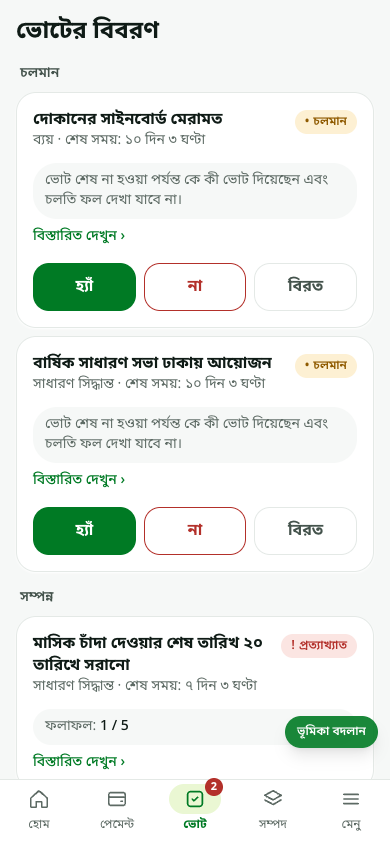

# Barakah Fund (tohobil)

A members' savings fund app: monthly dues, payments, a tamper-evident ledger, voting and reports.
It's a mobile-first PWA for members and a desktop workspace for the cashier and the auditor.
The interface is Bengali, with an English switch.

### [▶ Live demo: tohobildemo.moshiur.space](https://tohobildemo.moshiur.space/)

Pick a role on the sign-in screen. No PIN is needed:

| Role | What to look at |
|---|---|
| **Cashier** (M01) | Dashboard, member × month matrix, payment approvals, ledger, proposals, reports |
| **Auditor** (M07) | The same books, checked read-only |
| **Member** (M02) | The phone app: what I owe, paying, voting, the shared ledger. Best viewed at phone width |

The demo runs entirely in the browser on data recorded from a made-up fund. You can try every
form, but nothing is saved. Tip: switch to English with the **EN** button in the menu.

## Screenshots

| Cashier dashboard | Payment matrix |
|---|---|
|  |  |

| Member home | Paying dues | Voting |
|---|---|---|
|  |  |  |

## Highlights

- **Ledger you can't edit.** Financial records are never changed or deleted. Mistakes are fixed
  with reversal entries, database triggers enforce this, and a hash chain lets anyone verify the
  ledger.
- **Money done right.** Every amount is integer paisa (bigint), never a float, end to end.
- **Real-world payments.** Members report bKash, Nagad, bank or cash payments. The cashier pastes
  the bKash SMS, and the app matches and allocates it to the oldest dues.
- **Governance.** Proposals for expenses, investments, payouts, rule changes and more, with one
  member one vote.
- **Built for its users.** Mobile-first member app, member ID + PIN sign-in, an authenticator step-up
  for cashier actions, works offline as a PWA, light and dark themes, axe-checked accessibility.

## Tech stack

**Web:** React 18, TypeScript, Vite, Tailwind CSS, Radix UI, TanStack Query, i18next, PWA (Workbox), Capacitor for Android

**API:** Node 22, Fastify, Zod (schemas shared with the web app), PostgreSQL, pg-boss jobs, Argon2, TOTP, web push

**Quality:** Vitest, Testcontainers for database tests, Playwright end-to-end scenarios, axe accessibility checks, a 100k-row performance test

**Monorepo:** pnpm workspaces: `apps/api`, `apps/web`, `packages/shared`, `db`, `infra` (Docker)

## Run it locally

Needs Node 22+, pnpm (`corepack enable`) and Docker.

```bash
pnpm install
cp .env.example .env
docker compose -f infra/docker-compose.dev.yml up -d db
pnpm migrate && pnpm seed      # fictional sample members
pnpm dev                       # API on :3000, web on :5173
```

`pnpm check` runs lint, types, tests and the dependency audit. The demo is rebuilt with
`pnpm demo:record && pnpm demo:build` ([docs/DEMO.md](docs/DEMO.md)).
